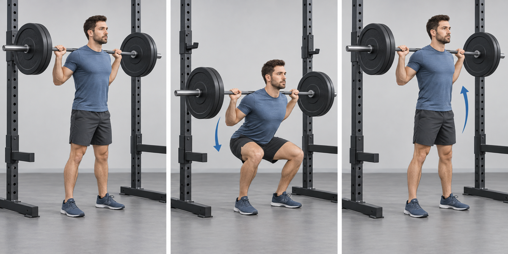
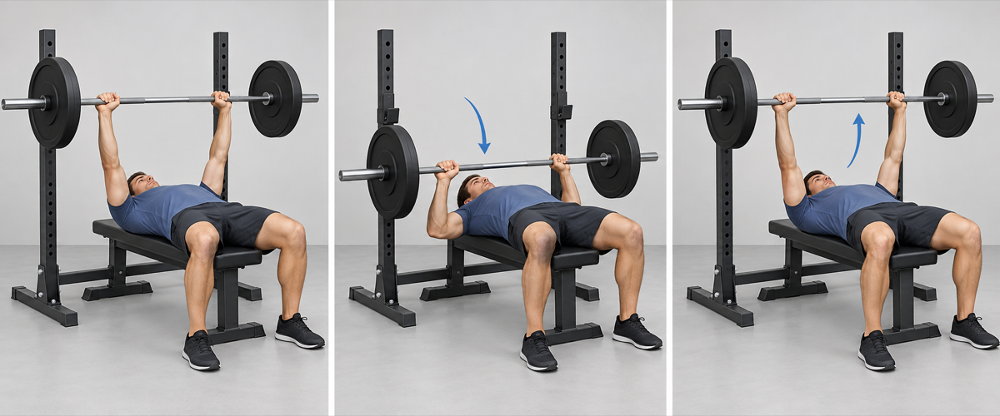
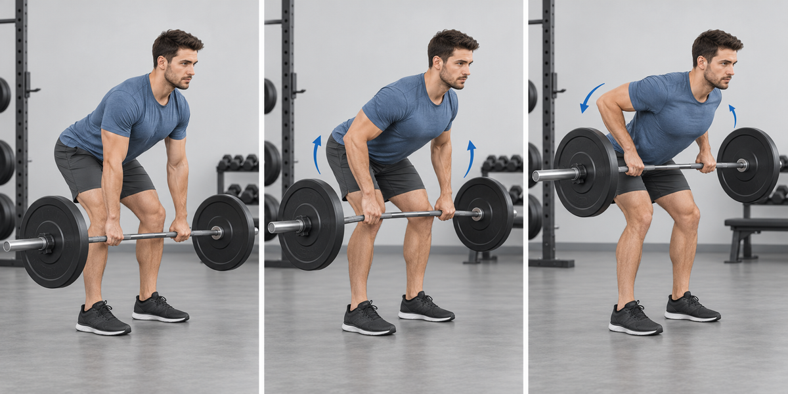
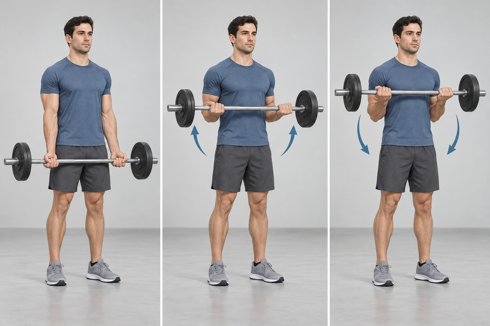

## 1. Barbell Back Squat

- **Work:** 4 × 5–6 · **Rest:** 120–150 sec
- **Cue:** Brace before descending; keep the whole foot planted and let the knees track over the toes.

## 2. Barbell Romanian Deadlift

- **Work:** 3 × 8 · **Rest:** 75–90 sec
- **Cue:** Push the hips back with soft knees and keep the bar close to the legs.

## 3. Barbell Bench Press

- **Work:** 4 × 5–6 · **Rest:** 120–150 sec
- **Cue:** Keep the shoulder blades set, feet planted, and lower the bar under control.

## 4. Bent-Over Barbell Row

- **Work:** 3 × 6–8 · **Rest:** 75–90 sec
- **Cue:** Hold a stable hip hinge and pull the bar toward the lower ribs without jerking.

## 5. Barbell Biceps Curl

- **Work:** 2 × 8–10 · **Rest:** 45–60 sec
- **Cue:** Keep the elbows near the torso and avoid leaning back.

## 6. Cable Triceps Pushdown

- **Work:** 2 × 8–10 · **Rest:** 45–60 sec
- **Cue:** Keep the upper arms still and fully extend the elbows without shrugging.

## 7. Forearm Plank

- **Work:** 3 × 30–45 sec · **Rest:** 30 sec
- **Cue:** Keep ribs down, glutes tight, and a straight line from shoulders to heels.

