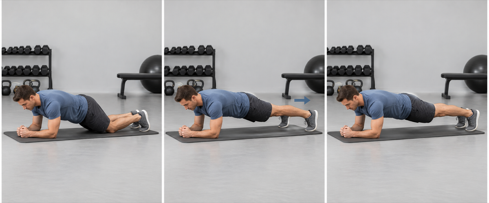
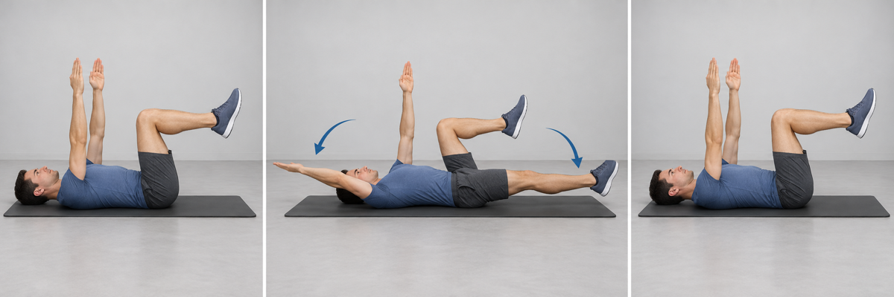
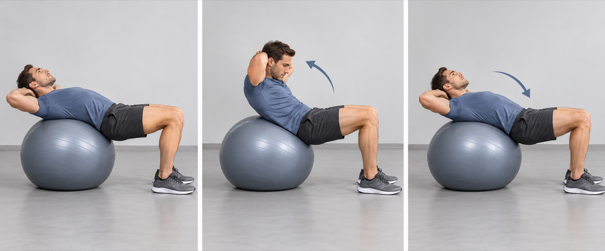
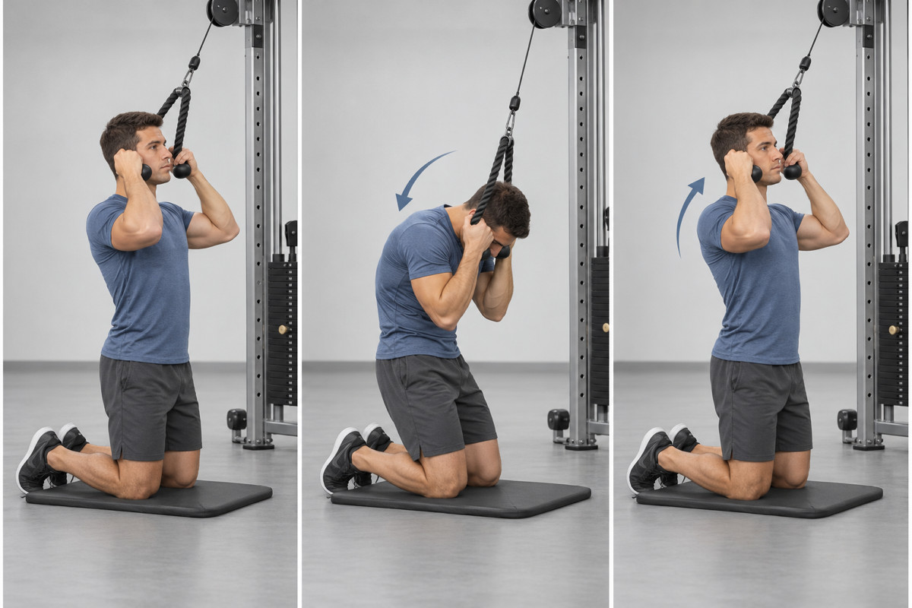
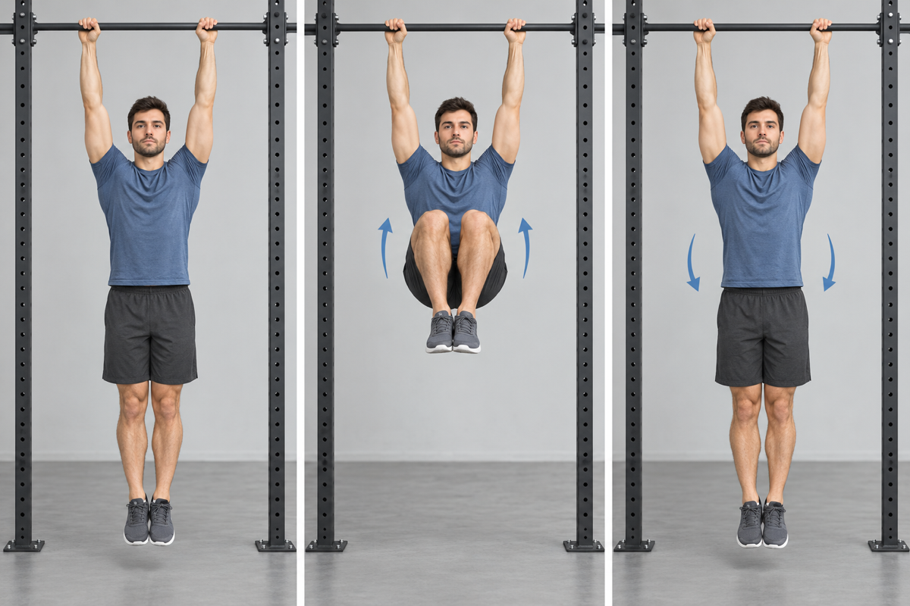
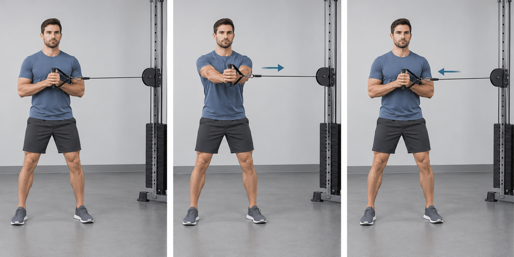

Choose **one or two exercises** after a workout, for a total of **4–6 working sets**. Avoid selecting two exercises from the same category on the same day. Quality and control matter more than speed.

## Anti-Extension

### Forearm Plank

- **Work:** 2–3 × 30–60 sec · **Rest:** 30–45 sec
- **Cue:** Keep the ribs down and avoid letting the lower back sag.

### Dead Bug

- **Work:** 2–3 × 8–12 each side · **Rest:** 30–45 sec
- **Cue:** Keep the lower back gently pressed down as opposite limbs extend.

## Trunk Flexion

### Stability-Ball Crunch

- **Work:** 2–3 × 12–20 · **Rest:** 30–45 sec
- **Cue:** Curl the ribs toward the pelvis without pulling the head forward.

### Cable Crunch

- **Work:** 2–3 × 10–15 · **Rest:** 45 sec
- **Cue:** Flex the trunk instead of sitting the hips back.

## Pelvic Curl and Lower Abs

### Reverse Crunch

- **Work:** 2–3 × 10–15 · **Rest:** 30–45 sec
- **Cue:** Curl the pelvis off the floor without swinging the legs.

### Hanging Knee Raise

- **Work:** 2–3 × 8–12 · **Rest:** 45–60 sec
- **Cue:** Start from a quiet hang and lift the knees without using momentum.

## Lateral Stability and Obliques

### Side Plank

- **Work:** 2–3 × 25–45 sec each side · **Rest:** 30 sec
- **Cue:** Stack the hips and keep the top shoulder from rolling forward.

### Pallof Press

- **Work:** 2–3 × 10–12 each side · **Rest:** 30–45 sec
- **Cue:** Press straight out and resist rotation toward the cable.

## Simple rotation

- **Workout A:** Forearm Plank
- **Workout B:** Pallof Press
- **Workout C:** Reverse Crunch
- **Workout D:** Side Plank
- **Workout E:** Dead Bug or Cable Crunch

