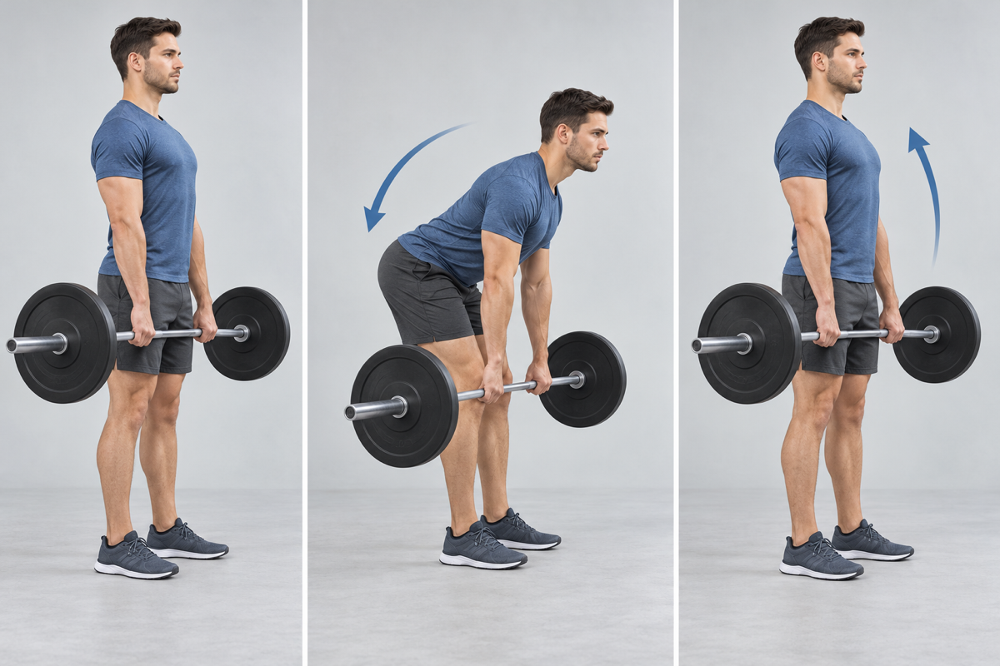
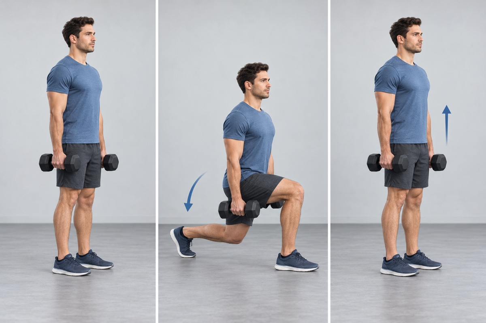
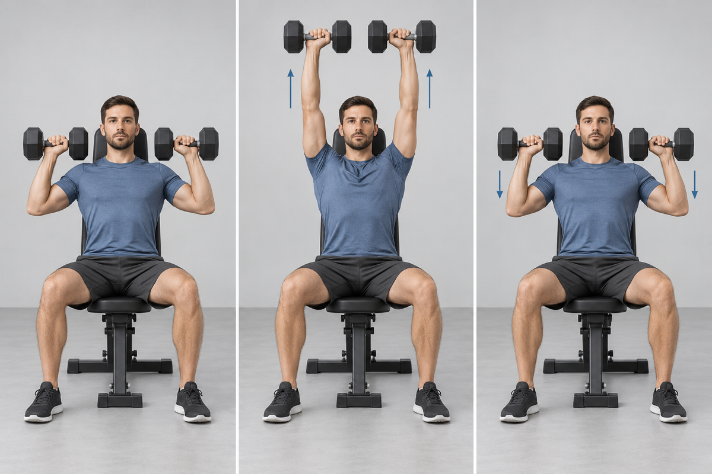
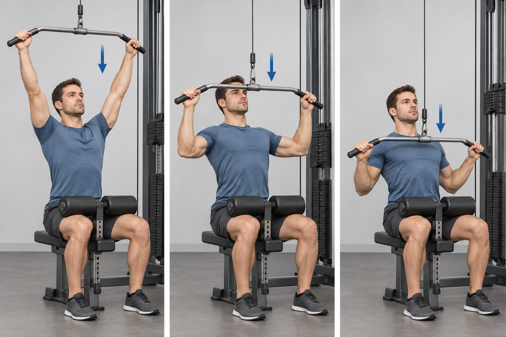
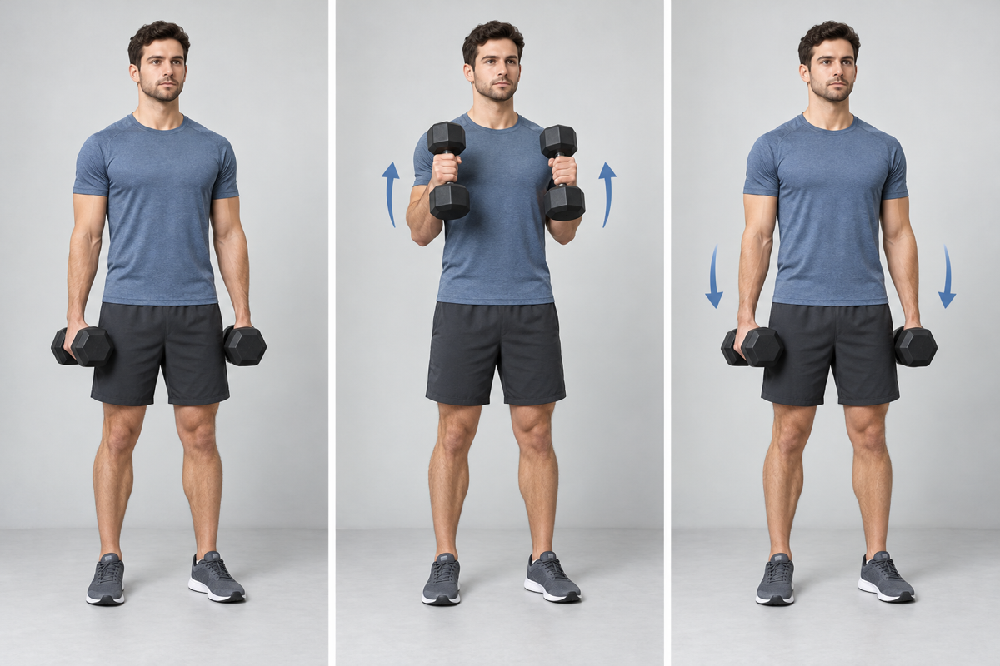
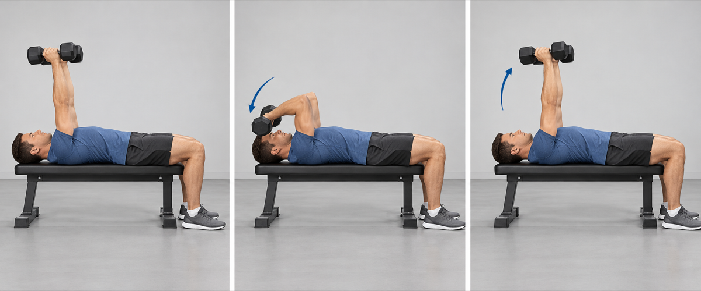
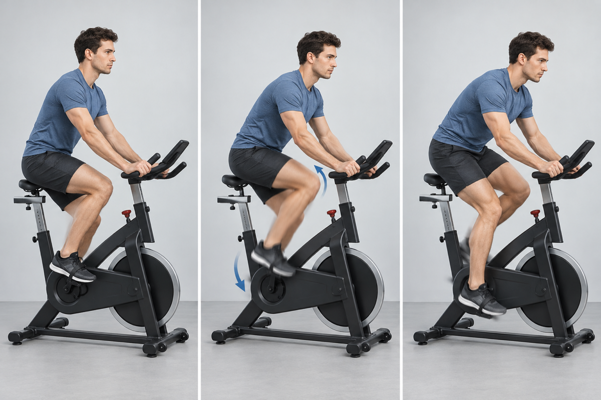

## 1. Barbell Romanian Deadlift

- **Work:** 4 × 6–8 · **Rest:** 120 sec
- **Cue:** Hinge at the hips, keep a neutral spine, and stop when hamstring tension limits the range.

## 2. Dumbbell Reverse Lunge

- **Work:** 3 × 8 each leg · **Rest:** 75 sec
- **Cue:** Step far enough back to keep the front foot planted and drive through the front leg.

## 3. Seated Dumbbell Shoulder Press

- **Work:** 3 × 8–10 · **Rest:** 75 sec
- **Cue:** Keep the ribs stacked over the pelvis and press without excessive back arching.

## 4. Lat Pulldown

- **Work:** 4 × 8–10 · **Rest:** 90 sec
- **Cue:** Pull the elbows toward the ribs and avoid swinging the torso.

## 5. Dumbbell Hammer Curl

- **Work:** 2 × 10–12 · **Rest:** 45–60 sec
- **Cue:** Keep a neutral grip and the elbows quiet beside the torso.

## 6. Lying Triceps Extension

- **Work:** 2 × 10–12 · **Rest:** 45–60 sec
- **Cue:** Move at the elbows while keeping the upper arms stable.

## 7. Bike Intervals

- **Work:** 6 rounds of 30 sec hard / 30 sec easy
- **Cue:** Use a repeatable hard pace; do not turn the first interval into an all-out sprint.

