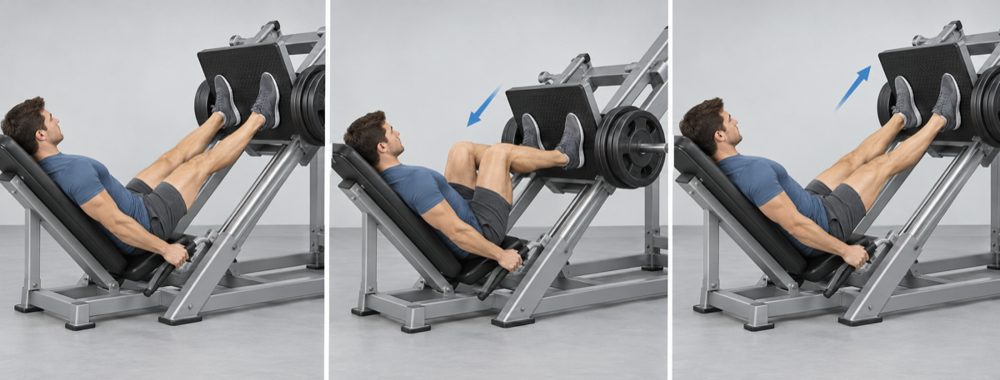
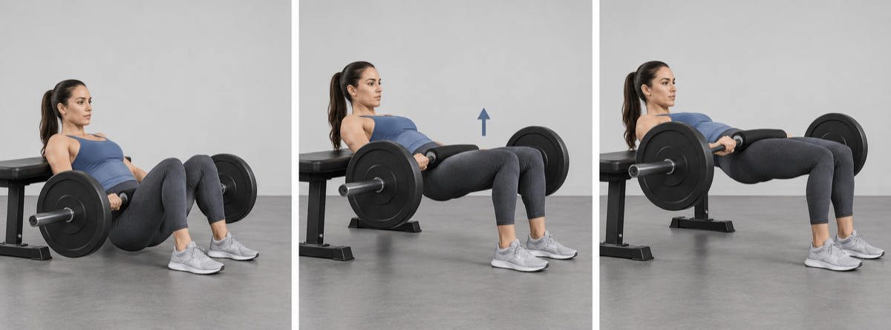
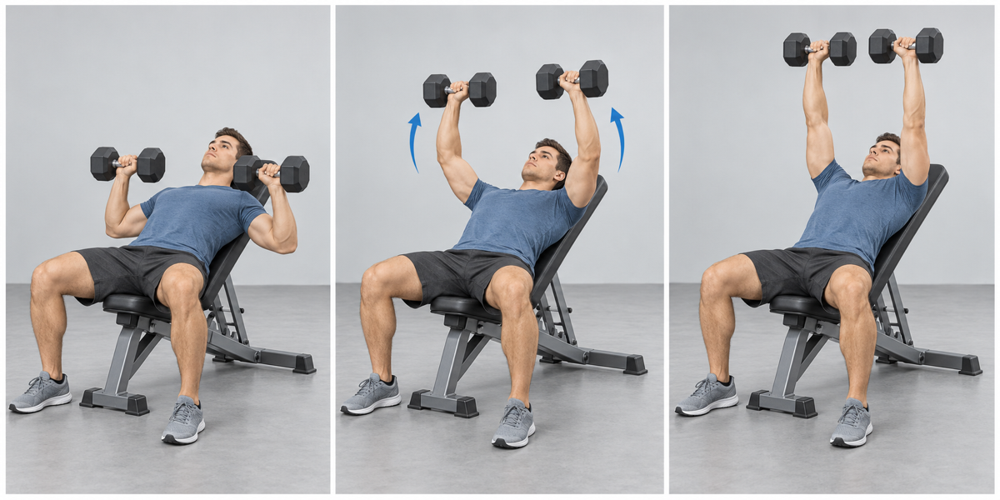
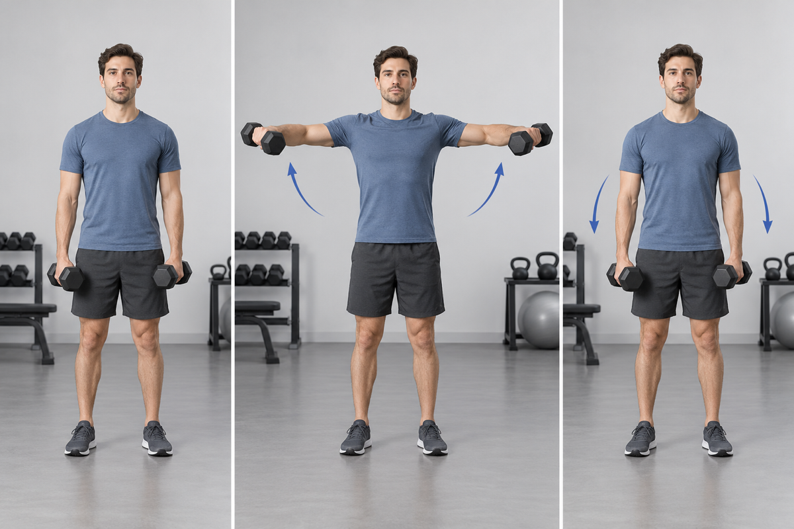
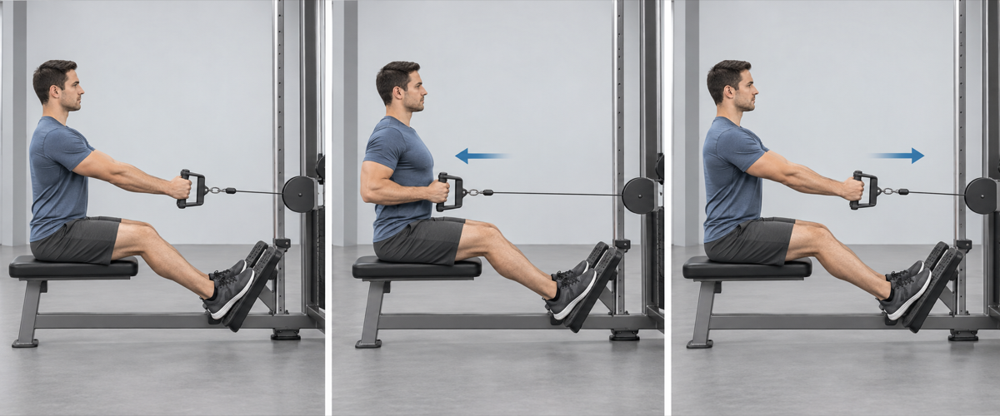
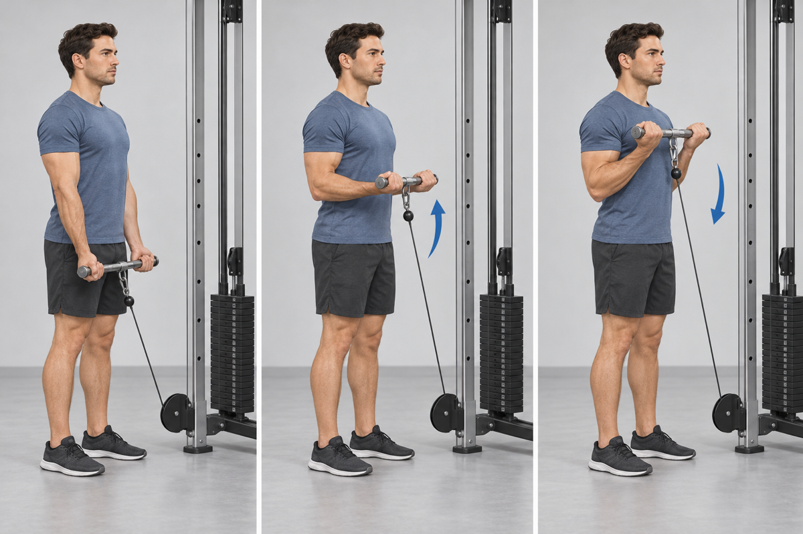
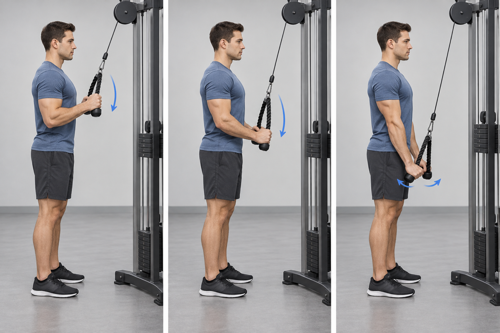
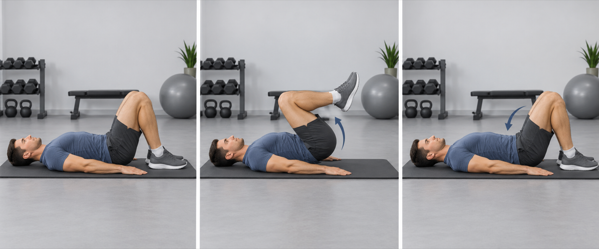

## 1. Leg Press

- **Work:** 4 × 10–12 · **Rest:** 90 sec
- **Cue:** Keep the hips against the pad and use a depth you can control without the pelvis curling.

## 2. Barbell Hip Thrust

- **Work:** 3 × 10–12 · **Rest:** 60–75 sec
- **Cue:** Finish with the ribs down and hips extended rather than arching the lower back.

## 3. Incline Dumbbell Press

- **Work:** 3 × 8–12 · **Rest:** 90 sec
- **Cue:** Set the shoulder blades and lower the dumbbells with the forearms nearly vertical.

## 4. Dumbbell Lateral Raise

- **Work:** 2 × 12–15 · **Rest:** 45 sec
- **Cue:** Raise with soft elbows and stop before the shoulders shrug.

## 5. Seated Cable Row

- **Work:** 3 × 10–12 · **Rest:** 60–75 sec
- **Cue:** Stay tall and pull toward the lower ribs while keeping the shoulders away from the ears.

## 6. Cable Biceps Curl

- **Work:** 2 × 12–15 · **Rest:** 45 sec
- **Cue:** Keep the elbows fixed and resist the cable on the way down.

## 7. Cable Triceps Pushdown

- **Work:** 2 × 12–15 · **Rest:** 45 sec
- **Cue:** Extend fully while keeping the upper arms close to the torso.

## 8. Reverse Crunch

- **Work:** 3 × 12–15 · **Rest:** 30 sec
- **Cue:** Curl the pelvis toward the ribs without swinging the legs.

