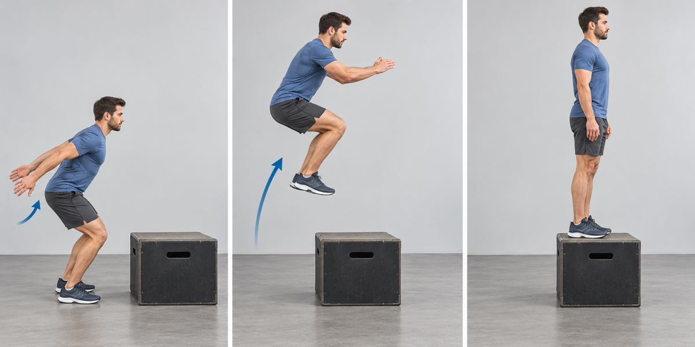
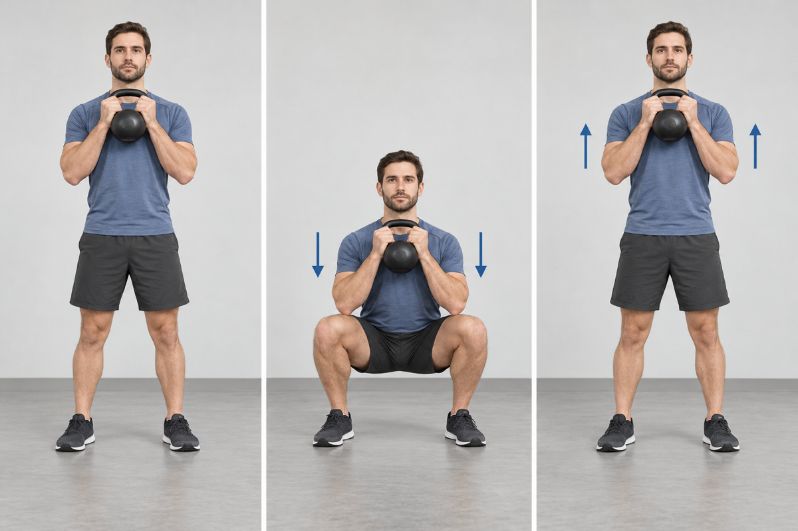
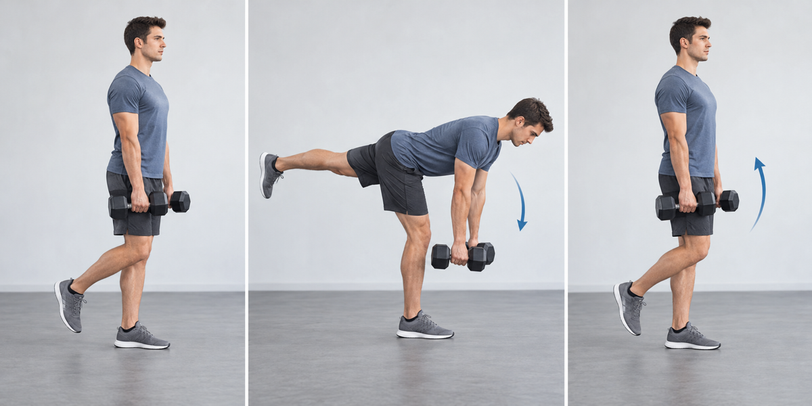
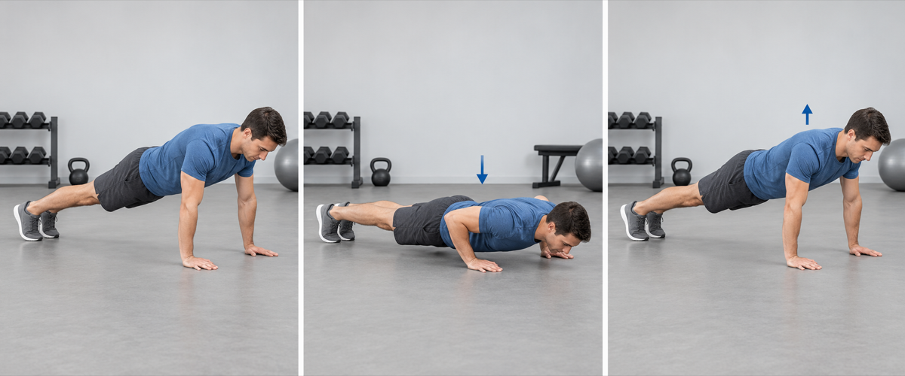
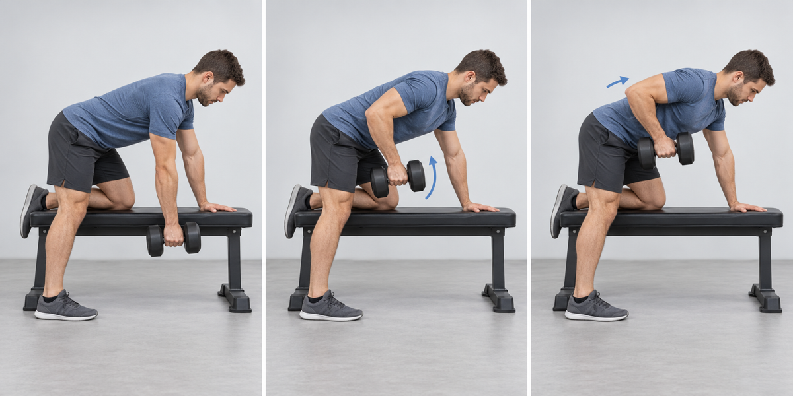
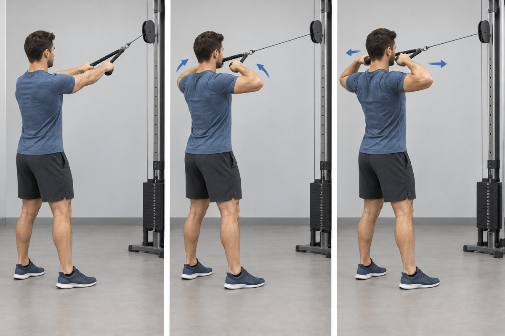
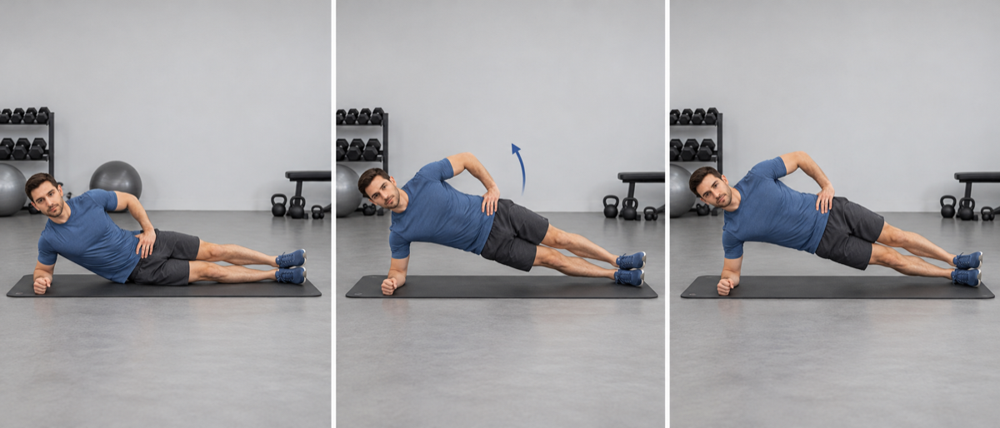
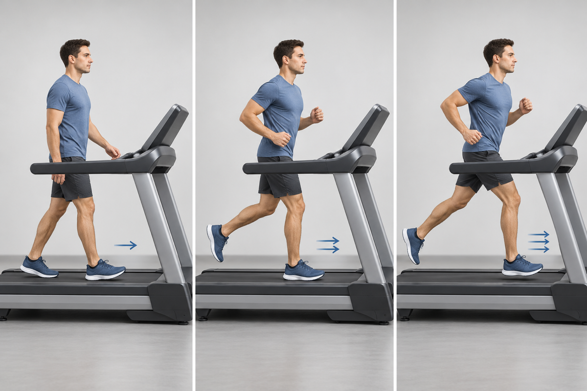

Use moderate loads. Move quickly with control and stop each set before speed or technique deteriorates.

## 1. Box Jump

- **Work:** 3 × 5 · **Rest:** 60 sec
- **Cue:** Use a stable box, land softly with the whole foot, then step down.

## 2. Goblet Squat

- **Work:** 3 × 10 · **Rest:** 60 sec
- **Cue:** Hold the weight close to the chest and keep the torso controlled through the full range.

## 3. Single-Leg Romanian Deadlift

- **Work:** 3 × 8 each leg · **Rest:** 60 sec
- **Cue:** Keep the hips square and reach the free leg back as the torso hinges forward.

## 4. Push-Up

- **Work:** 3 × 8–15 · **Rest:** 60 sec
- **Cue:** Keep a straight body line and lower the chest between the hands.

## 5. One-Arm Dumbbell Row

- **Work:** 3 × 10 each side · **Rest:** 60 sec
- **Cue:** Brace on the bench and pull toward the hip without rotating the torso.

## 6. Cable Face Pull

- **Work:** 2 × 12–15 · **Rest:** 30–45 sec
- **Cue:** Pull toward eye level and finish with the hands apart and shoulders down.

## 7. Side Plank

- **Work:** 2 × 30–40 sec each side · **Rest:** 30–45 sec
- **Cue:** Stack the shoulders and hips, then keep the body in one straight line.

## 8. Treadmill Intervals

- **Work:** 6 minutes, alternating 40 sec moderate / 20 sec hard
- **Cue:** Increase speed only while posture and foot placement remain controlled.

