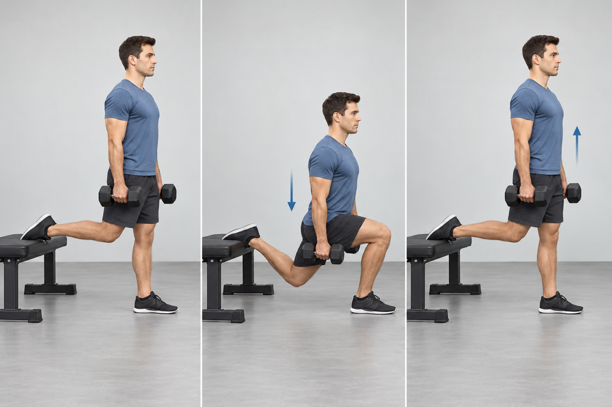
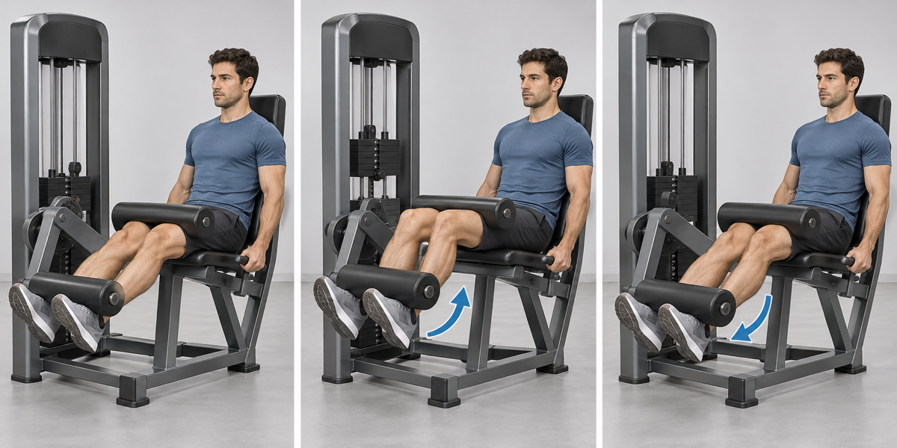
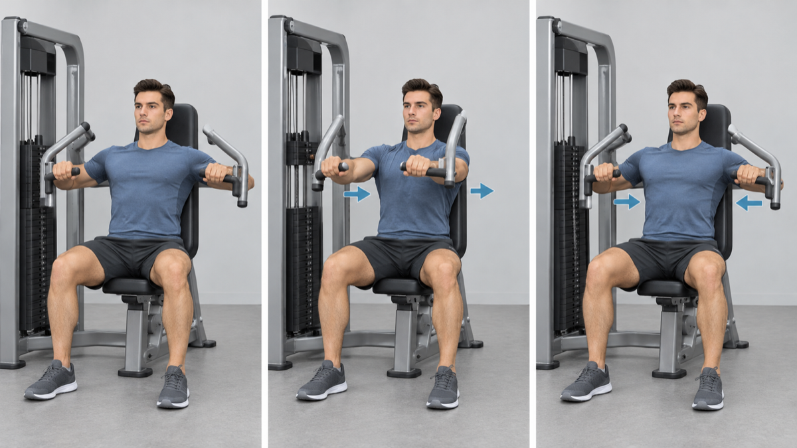
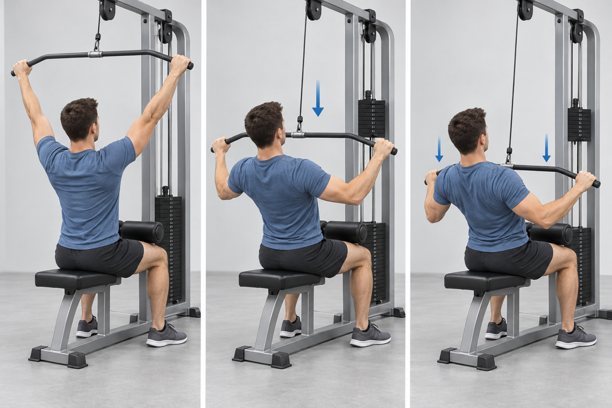
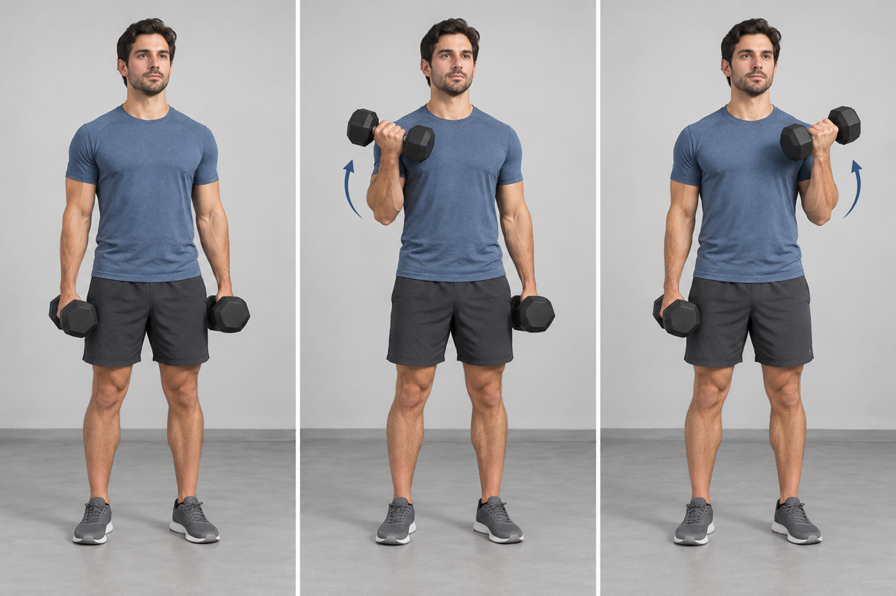
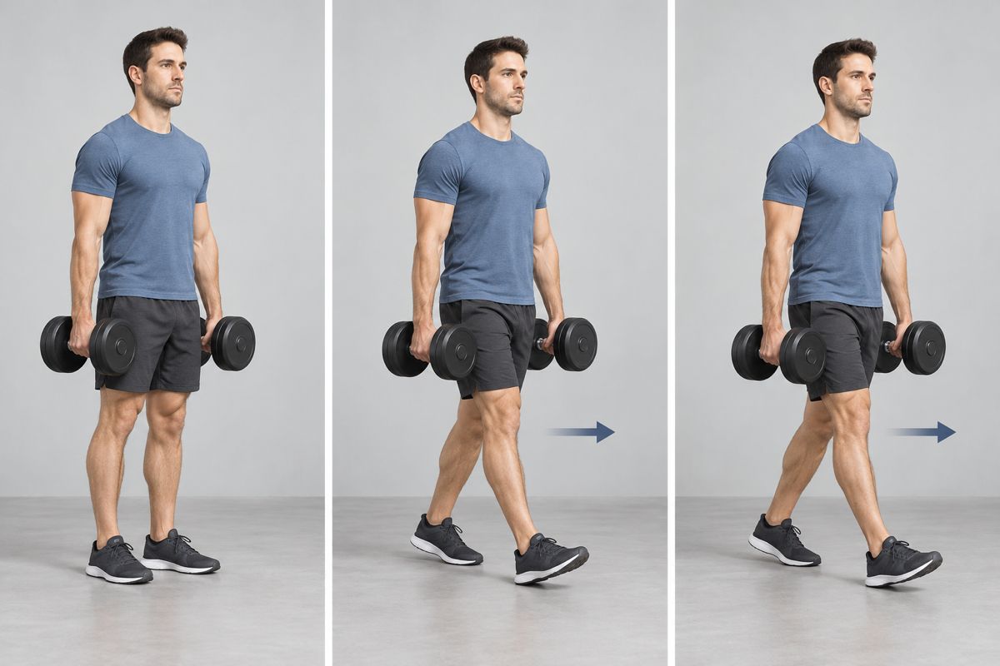

## 1. Bulgarian Split Squat

- **Work:** 3 × 10 each leg · **Rest:** 75 sec
- **Cue:** Set a stable stance, descend under control, and drive through the front foot.

## 2. Seated Leg Curl

- **Work:** 3 × 12–15 · **Rest:** 60 sec
- **Cue:** Keep the hips against the pad and curl through a controlled pain-free range.

## 3. Machine Chest Press

- **Work:** 3 × 12–15 · **Rest:** 60 sec
- **Cue:** Adjust the seat so the handles align near mid-chest and avoid shrugging.

## 4. Dumbbell Lateral Raise

- **Work:** 2 × 15–20 · **Rest:** 45 sec
- **Cue:** Use a light load and lift without momentum or shoulder elevation.

## 5. Wide-Grip Lat Pulldown

- **Work:** 3 × 12–15 · **Rest:** 60–75 sec
- **Cue:** Use a comfortable grip and pull to the upper chest without leaning far back.

## 6. Alternating Dumbbell Curl

- **Work:** 2 × 12–15 each arm · **Rest:** 45 sec
- **Cue:** Rotate the palm upward as you curl and keep the torso still.

## 7. Cable Triceps Pushdown

- **Work:** 2 × 12–15 · **Rest:** 45 sec
- **Cue:** Keep the shoulders relaxed and move only at the elbows.

## 8. Farmer Carry

- **Work:** 4 × 40 sec · **Rest:** 40 sec
- **Cue:** Walk tall with short controlled steps and avoid leaning toward either weight.

