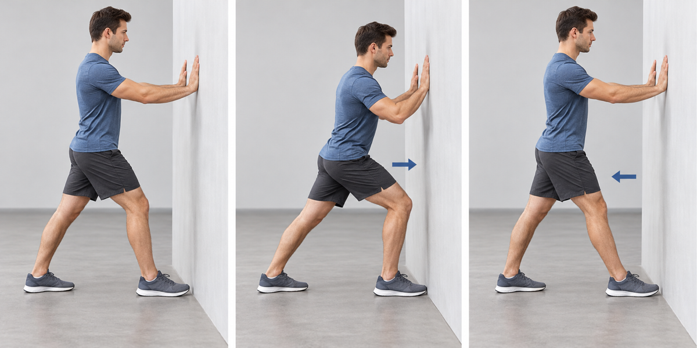
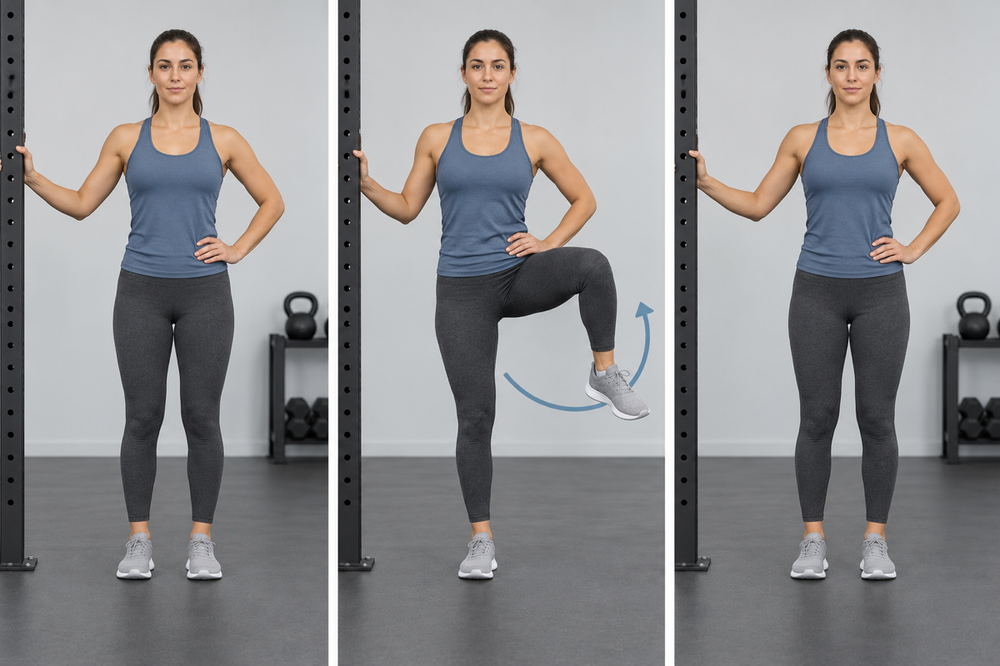
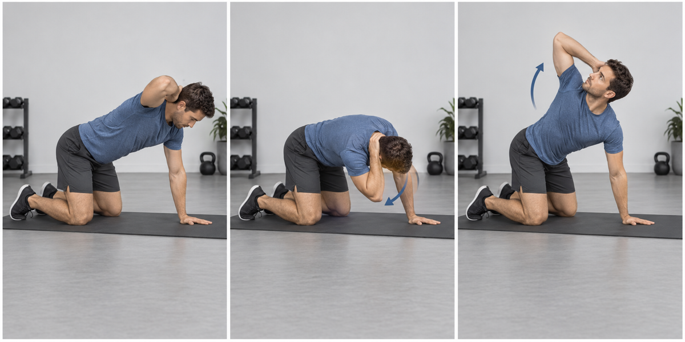
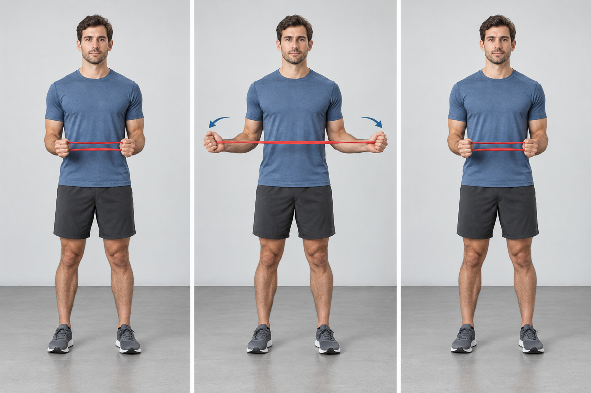
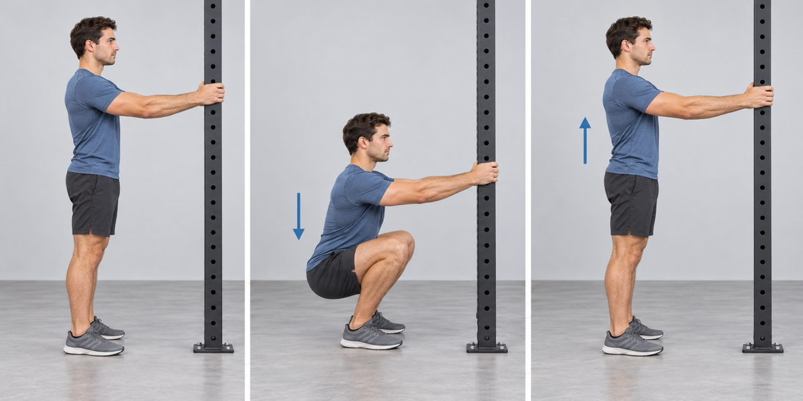
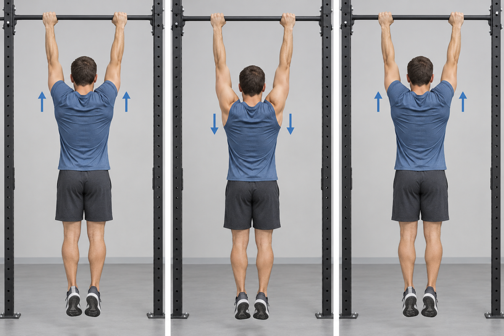

Complete one controlled round before every workout. The sequence takes approximately **6–8 minutes**. Stay within a pain-free range and do not add external load.

## 1. Knee-to-Wall Ankle Mobilization

- **Work:** 10 repetitions each side
- **Cue:** Keep the heel down while guiding the knee forward over the middle toes.

## 2. Standing Hip Circles

- **Work:** 10 circles each direction
- **Cue:** Move slowly through the largest comfortable circle without twisting the planted foot.

## 3. Quadruped Thoracic Rotation

- **Work:** 8 repetitions each side
- **Cue:** Rotate through the upper back while the hips remain quiet.

## 4. Resistance-Band External Rotation

- **Work:** 12 repetitions
- **Cue:** Keep the elbows against the torso and use a light band.

## 5. Supported Deep Squat Hold

- **Work:** 20–30 seconds
- **Cue:** Hold a stable support, keep the heels grounded, and breathe normally.

## 6. Scapular Elevation and Depression

- **Work:** 10 controlled repetitions
- **Cue:** Move the shoulder blades up and down without bending the elbows.

## Final ramp-up

Perform two progressively heavier warm-up sets of the first exercise in the workout. These sets prepare the movement and do not count as working sets.

